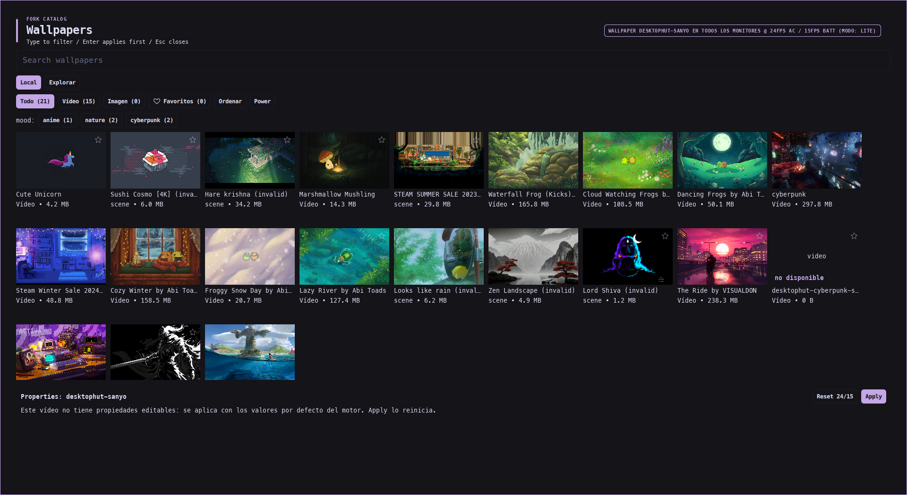
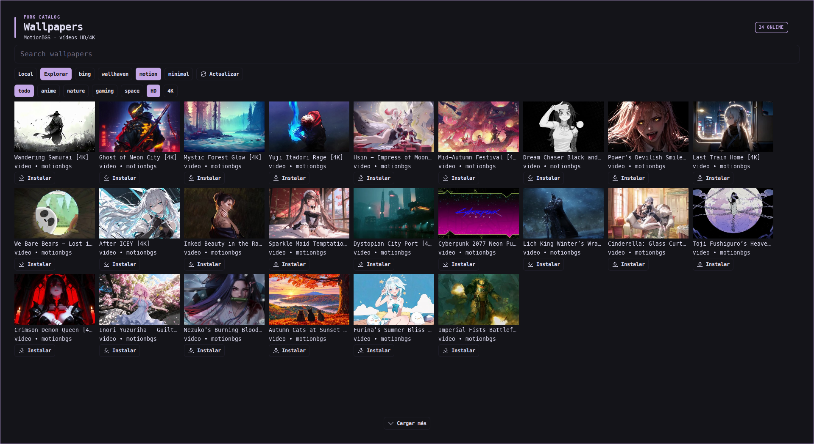

<p align="center">
  
</p>

# Linux Wallpaper Engine

High-performance, battery-aware Wallpaper Engine runtime for Linux with zero-duplicate multimonitor decoding, hardware acceleration, and native desktop integration.


-blue?style=flat-square)


> [!IMPORTANT]
> This branch (`feat/rebuild-from-scratch`) ships a ground-up C++23 rebuild of the
> runtime as the `we` binary. Build instructions, the CLI, the display backends
> and the current verification status are documented in
> [docs/REBUILD.md](docs/REBUILD.md). The legacy `linux-wallpaperengine` target of
> the sections below is kept for reference and is no longer compiled.

---

## Overview

This repository is an optimized fork of [Almamu/linux-wallpaperengine](https://github.com/Almamu/linux-wallpaperengine) engineered for daily driver laptop and multi-display workstation workflows. It brings animated wallpapers from Steam's Wallpaper Engine to Linux desktops without draining your battery or overloading your GPU.

```
[ Displays: eDP-1 (144Hz) + HDMI-1 (75Hz) ]
           │
           ├─► Viewport 1 (eDP-1)  ──┐
           │                         ├─► Shared CWallpaper Instance
           └─► Viewport 2 (HDMI-1) ──┘     ├─► Single libmpv Decoder (VA-API on iGPU)
                                           └─► Single Scene/Shader Frame Render
```

> [!NOTE]
> When cloning a wallpaper across multiple monitors, the engine deduplicates wallpaper instances. Video wallpapers execute **a single `libmpv` decode pipeline** and blit to each viewport, cutting CPU and GPU usage in half compared to independent instances.

---

## Key Features

* **Zero-Duplicate Multimonitor Decoding**
  * `--screen-all` automatically detects and spans/clones across all connected outputs (`eDP-1`, `HDMI-1`, `DP-1`).
  * Shared `CWallpaper` instances reuse video streams and rendered scene frames across viewports, eliminating duplicate decodes.
  * Independent per-screen configurations (`--screen-root <output> --bg <id>`) remain fully supported within a single process to prevent X11 root window pixmap flickering.
* **Intelligent Power Management**
  * Pinned power targets: **24 FPS on AC / 15 FPS on battery** out of the box.
  * Dynamic power-source polling via UPower with direct `/sys/class/power_supply` fallback.
  * Zero-wake idle detection (`--idle-pause <minutes>`) utilizing the X11 `MIT-SCREEN-SAVER` extension.
  * Preset profiles: `--profile lite` (15 FPS, disabled effects), `--profile balanced` (30 FPS), `--profile full` (60 FPS).
* **iGPU Isolation & Hardware Video Decoding**
  * Configurable hardware acceleration (`--hwdec vaapi-copy`, `vaapi`, `nvdec`, `cuda`, `vulkan`).
  * Seamless iGPU targeting (`DRI_PRIME`, `LIBVA_DRIVER_NAME=iHD`) allowing dedicated GPUs (e.g. NVIDIA RTX Optimus) to remain suspended in **D3cold** state.
* **C++ Local Library & Offline Catalog**
  * Built-in `Library` scanner (`--list-library`, `--search <query>`, `--json`, `--fav <id>`).
  * Persistent caching in `~/.cache/linux-wallpaperengine/library.json` with graceful handling of unsubscribed or missing workshop items.
* **MPRIS D-Bus Media Controller**
  * Built-in D-Bus media player server (`org.mpris.MediaPlayer2.linux-wallpaperengine`) exposing playback status, track metadata, and media key support.
* **Desktop Automation Suite (`we-wallpaper`)**
  * Unified management script for applying, switching, restoring, and querying wallpapers.
  * Web store scrapers for MotionBGS (4K/HD video), DesktopHut, Wallhaven, Bing Daily UHD, and Minimalist backgrounds.
  * Automatic synchronization with window manager color palettes and systemd user services.
* **Quickshell Gallery Interface**
  * Full desktop visual browser under `contrib/quickshell-gallery/` with search filters, real-time property tuning, and live explore tabs.

---

## Architecture & Visuals

### Local Library & Property Controls
The integrated Quickshell gallery provides instant browsing, property customization (colors, sliders, toggles), and active state badging:



### Web Catalog & Remote Discovery
Explore and download backgrounds directly from community sources without opening a browser:



---

## Prerequisites

To render Steam Workshop wallpapers, you must own and install **Wallpaper Engine** via Steam. The engine automatically inspects standard Steam library paths:

```
~/.steam/steam/steamapps/common/wallpaper_engine/assets
~/.local/share/Steam/steamapps/common/wallpaper_engine/assets
~/.var/app/com.valvesoftware.Steam/.local/share/Steam/steamapps/common/wallpaper_engine/assets
```

> [!IMPORTANT]
> If assets reside in a non-standard directory, provide the path via `--assets-dir /path/to/assets`.

### Dependencies

#### Fedora 40 / 41 / 42 / 44
```bash
sudo dnf install gcc g++ cmake libXrandr-devel libXinerama-devel libXcursor-devel \
  libXi-devel mesa-libGL-devel glew-devel freeglut-devel SDL2-devel lz4-devel \
  ffmpeg ffmpeg-free-devel libXxf86vm-devel glm-devel glfw-devel mpv mpv-devel \
  pulseaudio-libs-devel fftw-devel gmp-devel
```

#### Ubuntu 22.04 / 24.04
```bash
sudo apt-get install build-essential cmake libxrandr-dev libxinerama-dev libxcursor-dev \
  libxi-dev libgl-dev libglew-dev freeglut3-dev libsdl2-dev liblz4-dev libavcodec-dev \
  libavformat-dev libavutil-dev libswscale-dev libxxf86vm-dev libglm-dev libglfw3-dev \
  libmpv-dev mpv libpulse-dev libfftw3-dev libfreetype-dev
```

---

## Build & Installation

1. **Clone the repository:**
   ```bash
   git clone --recurse-submodules https://github.com/marodriguezd/linux-wallpaperengine.git
   cd linux-wallpaperengine
   ```

2. **Configure and compile:**
   ```bash
   mkdir -p build && cd build
   cmake -DCMAKE_BUILD_TYPE=Release ..
   make -j$(nproc)
   ```

3. **Install system-wide:**
   ```bash
   sudo install -m 755 output/linux-wallpaperengine /opt/fork/linux-wallpaperengine
   sudo install -m 755 output/liblinux-wallpaperengine-lib.so /opt/fork/liblinux-wallpaperengine-lib.so
   install -m 755 ../tools/we-wallpaper ~/.local/bin/we-wallpaper
   ```

---

## Quickstart & Examples

### Multimonitor Cloned Setup (Shared Decode)
Replicate a wallpaper across all active outputs with a single video decode pass:
```bash
linux-wallpaperengine --screen-all --bg 3726414565 --fps 24 --scaling fill --silent
```

### Multimonitor Independent Setup
Display distinct backgrounds per monitor in a single process without root pixmap collision:
```bash
linux-wallpaperengine \
  --screen-root eDP-1 --bg desktophut-sanyo \
  --screen-root HDMI-1 --bg 3726414565 \
  --fps 24 --scaling fill --silent
```

### Span Across Multiple Displays
Stretch a single high-resolution background across combined monitors:
```bash
linux-wallpaperengine --screen-span eDP-1,HDMI-1 --bg 1845706469 --scaling fill
```

### Automation with `we-wallpaper`
The companion helper simplifies daily execution:

```bash
# Check status, running PID, and hardware usage
we-wallpaper status

# View detected screens and multimonitor mode
we-wallpaper screens

# Set multimonitor mode (clone or single)
we-wallpaper multimonitor clone

# Apply a wallpaper across all screens
we-wallpaper apply-all desktophut-sanyo lite

# Apply different wallpapers per screen
we-wallpaper apply-screen eDP-1 desktophut-sanyo lite
we-wallpaper apply-screen HDMI-1 3726414565 lite

# Inspect or adjust persistent power configuration
we-wallpaper power
we-wallpaper power-set WE_FPS=24 WE_FPS_BATTERY=15 WE_HWDEC=vaapi-copy

# Toggle favorite
we-wallpaper fav 3726414565
```

---

## CLI Options Reference

| Flag / Option | Description |
| :--- | :--- |
| `--screen-all` | Replicate wallpaper on all detected screens with shared decode |
| `--screen-root <output>` | Target specific monitor (e.g. `eDP-1`, `HDMI-1`) |
| `--screen-span <o1,o2>` | Stretch wallpaper across listed displays |
| `--bg <id/path>` | Specify background Steam Workshop ID or path |
| `--fps <n>` | Set maximum target frame rate on AC (default: `24`) |
| `--fps-battery <n>` | Target frame rate when on battery (default: `15`, `0` = pause) |
| `--pause-on-battery` | Fully freeze rendering when disconnected from AC |
| `--idle-pause <min>` | Pause rendering when user is inactive for N minutes (X11) |
| `--hwdec <backend>` | Set mpv hardware decoding backend (`auto`, `vaapi-copy`, `nvdec`, `cuda`) |
| `--profile <mode>` | Instant configuration profile (`lite`, `balanced`, `full`) |
| `--scaling <mode>` | Texture scaling mode: `fill`, `fit`, `stretch`, or `default` |
| `--clamping <mode>` | Texture clamping mode: `clamp`, `border`, `repeat` |
| `--silent`, `-s` | Disable wallpaper audio playback |
| `--volume <0-128>` | Set wallpaper audio volume |
| `--list-properties` | Output customizable wallpaper shader properties |
| `--set-property k=v` | Override wallpaper property (color, toggle, speed, amount) |
| `--list-library` | Scan and list installed workshop items |
| `--search <term>` | Query installed library items |
| `--json` | Format library and property listings as JSON |
| `--version` | Display fork version and feature flags |

---

## Configuration & Persistence

Runtime power parameters are stored in `~/.config/we-wallpaper/power.conf`:

```ini
WE_PROFILE=
WE_FPS=24
WE_FPS_BATTERY=15
WE_PAUSE_ON_BATTERY=0
WE_IDLE_PAUSE=0
WE_BACKEND=x11
WE_LAYER=bottom
WE_PAUSE_ACTIVE_ONLY=0
WE_PAUSE_IGNORE_APPID=
WE_NO_FULLSCREEN_PAUSE=0
WE_HWDEC=vaapi-copy
WE_MULTIMONITOR=clone
```

> [!TIP]
> Environment variables take precedence over `power.conf`. You can temporarily override any setting for testing:
> ```bash
> WE_FPS=60 we-wallpaper restore
> ```

---

## Systemd Service Integration

For background execution on session login, enable the user service:

```bash
systemctl --user enable --now we-wallpaper.service
```

This service invokes `we-wallpaper restore` after your display manager and X11/Wayland socket are available.
