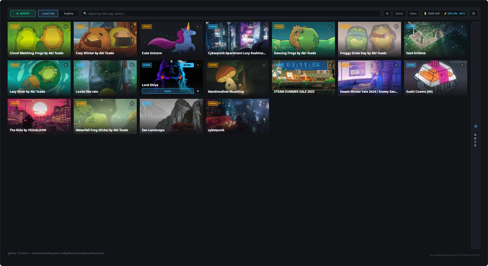
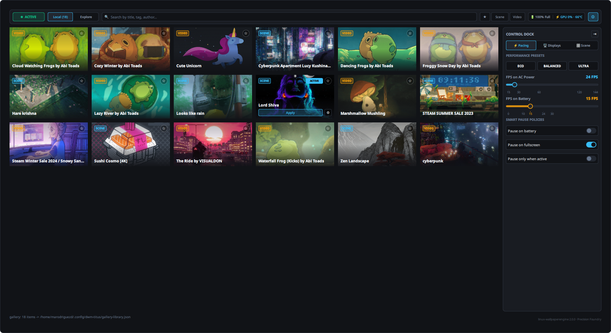
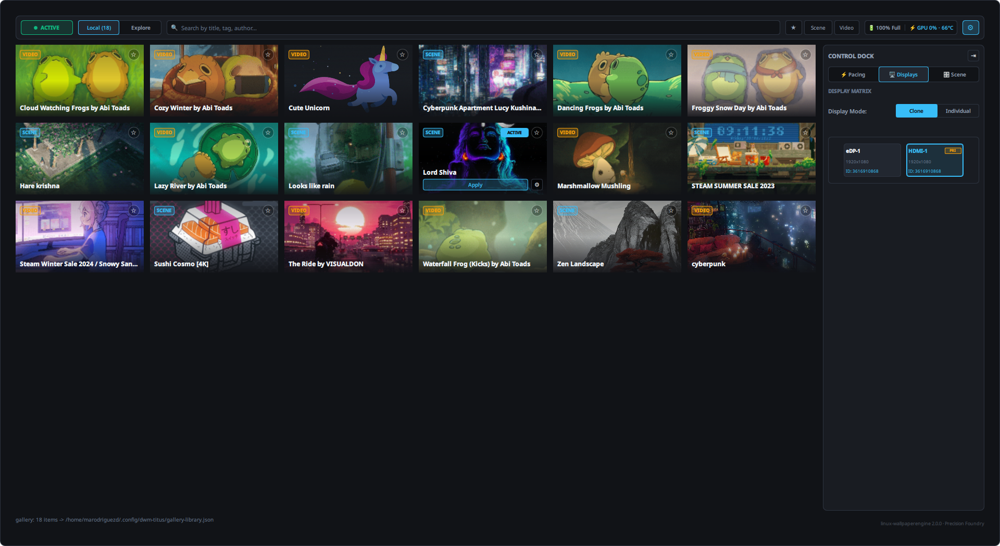
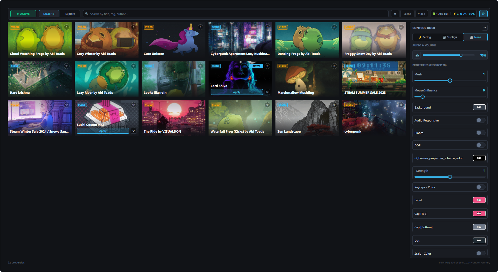

<p align="center">
  
</p>

<h1 align="center">Linux Wallpaper Engine</h1>

<p align="center">
  <strong>High-performance, modern C++23 Wallpaper Engine runtime, renderer, and desktop control suite for Linux.</strong>
</p>

<p align="center">
  <a href="#building"></a>
  <a href="#architecture"></a>
  <a href="#building"></a>
  <a href="#display-backends"></a>
  <a href="#quickshell-control-dock"></a>
</p>

---

## Overview

**Linux Wallpaper Engine** brings animated Steam Wallpaper Engine wallpapers to Linux desktops without draining laptop battery or overloading GPU resources. Re-engineered completely from the ground up in modern **C++23**, the engine replaces legacy implementations with a modular, zero-copy architecture designed for high efficiency and flawless visual fidelity.

Whether running complex 3D scenes with real-time particle simulations, multi-pass bloom post-processing, PBR lighting, or hardware-decoded 4K video, the engine guarantees a single compositing and decoding pass across all connected monitors.

```
[ Monitors: eDP-1 (144Hz Primary) + HDMI-1 (75Hz Secondary) ]
           │
           ├─► Output 1 (eDP-1)  ──┐
           │                       ├─► Shared Wallpaper Instance
           └─► Output 2 (HDMI-1) ──┘     ├─► Single libmpv Decoder (RGBA16F zero-copy)
                                         └─► Single Scene / Particles / FBO Post-Processing Pass
```

> [!TIP]
> **Single-Pass Multi-Monitor Pipeline**: Regardless of monitor count or display resolutions, video decoding and scene compositing execute exactly once per frame. The resulting texture is shared directly across all output swapchains, saving substantial GPU memory bandwidth and keeping power consumption minimal on both AC and battery.

---

## Quickshell Control Dock & Gallery

The desktop experience is anchored by a companion control gallery built with **Quickshell** (`contrib/quickshell-gallery/`). Following a refined **Master-Detail** architectural model and the **"Precision Foundry"** design token system (`#111317` void base, `#191C22` surface, `#38BDF8` pacing cyan, `#F59E0B` telemetry amber), it provides an integrated floating suite to browse, configure, and monitor wallpapers live.

<p align="center">
  
</p>
<p align="center"><em>Panoramic view of the Quickshell Gallery featuring the OmnibarHeader, media-first 16:9 card grid, active wallpaper pill, search filter, and live engine telemetry.</em></p>

### Interactive Inspection Panes

The collapsible **Control Dock** exposes three dedicated inspectors for runtime customization:

| Tab | Interface Preview | Functionality |
| :--- | :--- | :--- |
| **⚡ Pacing & Performance** |  | **1-Click Performance Presets**: Instant switching between **ECO** (30 FPS AC / 15 FPS Battery), **BALANCED** (60 FPS AC / 30 FPS Battery), and **ULTRA** (Uncapped native display refresh rate, e.g., 144 Hz).<br/><br/>**Granular FPS Sliders**: Continuous pacing adjustments with physical tick markers for both AC and battery power states.<br/><br/>**Smart Energy Policies**: Seamless toggles for battery pause when unplugged and fullscreen window occlusion pausing. |
| **🖥 Displays & Outputs** |  | **Interactive Screen Matrix**: Full topology visualizer (`ScreenMatrixSelector`) rendering all active outputs (`eDP-1`, `HDMI-1`) with resolution and refresh telemetry.<br/><br/>**Flexible Layout Modes**: Toggle between **Clone Mode** (single synchronised wallpaper spanned across outputs) and **Individual Mode** (independent wallpapers per monitor).<br/><br/>**Instant Target Assignment**: Direct 1-click wallpaper application to selected outputs via `apply-screen`. |
| **🎛 Scene & Audio** |  | **Dynamic Polymorphic Properties**: Inspects and edits wallpaper variables declared in `project.json` and saved per wallpaper to `props.conf`.<br/><br/>**Rich Inspector Controls**: Live RGB color chips with hex inputs, continuous floating-point and integer sliders, and boolean toggles.<br/><br/>**Audio Control Suite**: Master volume level slider, 1-click audio mute toggle, and audio reactive channel configuration. |

---

## Core Engine Highlights (C++23 Rebuild)

### 1. Canonical Coordinate Mapping
Matches Wallpaper Engine's native coordinate system: origin at the top-left with $y$-down in `scene.json`. The scene compiler projects geometry into an OpenGL-standard centered world with $y$-up. Quad positions use object centers (`origin`), layer dimensions are multiplied by `scale`, and orientation angles (`angles.z`) are evaluated in clockwise radians.

### 2. In-Situ `.pkg` Archive & Case-Insensitive VFS
Archives (`scene.pkg`, `gifscene.pkg`) are mapped directly into virtual memory via `mmap` with zero disk extraction. The virtual filesystem (VFS) normalizes Windows-style backslashes (`\`) and resolves casing mismatches on Linux ext4/Btrfs filesystems with cached directory indexing, avoiding filesystem traversal penalties.

### 3. Broad Texture & Compression Format Support
High-performance native decoding for Wallpaper Engine `TEX` and `TEXB` formats across all common block and uncompressed pixel layouts:
* **Block Compression**: DXT1 (BC1), DXT3 (BC2), DXT5 (BC3), and BC7 (BPTC).
* **Uncompressed Formats**: ARGB8888, RGB888, RGB565, and R8.
* **Dual-Mode RG88**: Automatically handles both standard two-channel normal/flow maps and `TextureFlags_AlphaChannelPriority` luminance-alpha textures.
* **Animated Spritesheets**: Decodes `TEXS0001` and `TEXS0003` animated atlas sheets with frame-time cycling, sub-rectangle UV cropping, and frame indices.

### 4. Real-Time Particle Simulation Engine
A dedicated simulation subsystem optimized for high particle counts with zero per-frame heap allocations:
* **Emission Models**: Box (`boxrandom`) and spherical (`sphererandom`) volume emitters with continuous emission rates and burst spawning.
* **Physics & Dynamics**: Gravity vectors, planar drag, velocity inheritance, angular velocity, and turbulence.
* **Particle Lifecycles**: Multi-point alpha fade-in/fade-out curves, size-over-lifetime scaling, animated sprite trails, and simulation prewarming to prevent cold starts.

### 5. Offscreen FBO Post-Processing & Bloom Ping-Pong
* **Render Targets**: Full support for internal framebuffers (`_rt_FullFrameBuffer`) with multi-pass ping-pong rendering.
* **High-Quality Bloom**: Multi-stage downsample and upsample blur passes with HDR thresholding.
* **Shader Post-Effects**: Chromatic aberration, blur kernels, dynamic scene timers (`g_Time`), and custom effect passes with additive blending.

### 6. Physically Based Lighting (PBR) & Reflections
* **Light Sources**: Real-time point lights (`lpoint`) with configurable falloff radiuses, colors, and global ambient irradiance terms.
* **PBR Shading**: Cook-Torrance GGX specular evaluation driven by multi-channel PBR material masks (`metallic`, `roughness`, `reflection`, `emissive`).
* **Screen-Space Reflections**: Normal-mapped reflections sampling the composite scene framebuffer.

### 7. Parallax Inertia Camera & Cursor Tracking
Camera layers respond dynamically to cursor motion with configurable inertia, spring dampening, and multi-layer depth displacement. The engine transparently queries root pointer coordinates across both **X11** (`XQueryPointer`) and **Wayland** environments.

### 8. Hardware-Accelerated Video Decoding
Integrated `libmpv` pipeline rendering directly into 16-bit floating-point textures (`GL_RGBA16F`), avoiding banding artifacts on Mesa drivers. Embedded MP4 video streams packed inside `TEXB` texture containers (identified by the `ftyp` box marker at byte offset 4) are detected automatically and decoded as live video textures.

### 9. Audio Reactive Processing & Scene Sound Channels
Real-time audio waveform and frequency spectrum analysis feeds audio-reactive wallpaper shaders and particle emitters. Scene sound layers play back with per-channel volume mixing, loop flags, and spatial attenuation.

---

## Display Backends

The engine includes native drivers for modern Linux display servers and compositors:

| Backend | Platform | Presentation Architecture | Recommended Use Case |
| :--- | :--- | :--- | :--- |
| `x11-desktop` | X11 | EGL window with `_NET_WM_WINDOW_TYPE_DESKTOP`, `BELOW`, `STICKY` | Default for modern composited X11 desktops (GNOME X11, KWin X11, Xfce, Picom). |
| `x11-root` | X11 | Fullscreen EGL window covering all outputs / MIT-SHM root pixmap | Traditional tiling and lightweight window managers (i3, bspwm, dwm, Openbox). |
| `wayland` | Wayland | `zwlr_layer_shell_v1` on background / bottom layer per `wl_output` | Modern Wayland compositors (Hyprland, Sway, River, Wayfire). |
| `headless` | Headless | EGL PBuffer / Surfaceless offscreen context | Automated CI testing, offline rendering, and PNG generation (`--screenshot`). |

---

## Frontends & GUI Ecosystem

In addition to the main Quickshell Control Dock, Linux Wallpaper Engine integrates into diverse desktop environments:

```
┌────────────────────────────────────────────────────────────────────────┐
│                        Linux Wallpaper Engine                          │
└───────────────────────────────────┬────────────────────────────────────┘
                                    │
    ┌───────────────────────────────┼───────────────────────────────┐
    │                               │                               │
┌───▼──────────────────────┐  ┌─────▼────────────────────┐  ┌───────▼────────────────────┐
│    Quickshell Gallery    │  │    Standalone Web UI     │  │    Rofi / dmenu / CLI      │
│  contrib/quickshell-     │  │   contrib/web-gallery/   │  │    tools/we-wallpaper      │
│  gallery/                │  │                          │  │                            │
│  Full desktop UI with    │  │  Zero-dependency browser │  │  Fast terminal launcher    │
│  Control Dock & sliders  │  │  telemetry & preview grid│  │  and window manager menus  │
└──────────────────────────┘  └──────────────────────────┘  └────────────────────────────┘
```

1. **Quickshell Gallery (`contrib/quickshell-gallery/`)**: Native Wayland/X11 floating interface with live properties, telemetry, and monitor routing.
2. **Standalone Web Gallery (`contrib/web-gallery/`)**: Zero-dependency local web dashboard (`index.html`) providing responsive grid previews, telemetry monitoring, and CLI command generation.
3. **Desktop Launcher (`tools/we-wallpaper`)**: Scriptable wrapper for Rofi, dmenu, and fzf:
   ```bash
   we-wallpaper grid           # Visual wallpaper picker with thumbnails in Rofi
   we-wallpaper switch         # Cascading menu (rofi -> dmenu -> fzf -> terminal)
   we-wallpaper apply-screen eDP-1 3615154110  # Apply wallpaper to a specific monitor
   we-wallpaper power-set FPS=144 BATTERY_FPS=30 PAUSE_ON_BATTERY=1
   ```

---

## Architecture & Codebase Map

The C++23 rebuild is structured into clean, decoupled static libraries under `src/`:

```
src/
├── core/       # std::expected error types, logging, math (Vec2/3/4, Mat4), LZ4, memory-mapped files
├── steam/      # KeyValues VDF parser, Steam library discovery, case-insensitive VFS, .pkg reader
├── gfx/        # EGL contexts, GLSL shaders, textures, framebuffers, batch quad renderer
├── display/    # Display backends: x11-desktop, x11-root, wayland (wlr-layer-shell), headless
├── scene/      # project.json/scene.json, TEXB, spritesheets, particles, FBO post-processing, libmpv
├── power/      # Battery monitoring (UPower/sysfs), monotonic frame pacer (clock_nanosleep)
├── presets/    # Performance profile management (battery, balanced, smooth)
├── app/        # Engine core lifecycle, output monitor management, render loop coordinator
└── cli/        # The 'we' unified command line executable
```

> [!NOTE]
> The legacy C++17 implementation in `src/WallpaperEngine/` and `src/Steam/` is maintained exclusively for historical reference and is excluded from compilation and testing.

---

## Installation & Dependencies

### Prerequisites
To render Steam Workshop wallpapers, install [Wallpaper Engine](https://store.steampowered.com/app/431960/Wallpaper_Engine/) through Steam. The engine automatically discovers library locations, workshop subscriptions, and shared assets.

### Package Requirements

#### Fedora (40 / 41 / 42+)
```bash
sudo dnf install gcc g++ cmake ninja-build \
  mesa-libEGL-devel mesa-libGL-devel libX11-devel libXrandr-devel libXext-devel libXfixes-devel \
  wayland-devel wayland-protocols-devel mpv-libs-devel nlohmann-json-devel
```

#### Ubuntu / Debian (24.04+)
```bash
sudo apt-get install build-essential cmake ninja-build \
  libegl1-mesa-dev libgl1-mesa-dev libx11-dev libxrandr-dev libxext-dev libxfixes-dev \
  libwayland-dev wayland-protocols libmpv-dev nlohmann-json3-dev
```

#### Arch Linux
```bash
sudo pacman -S base-devel cmake ninja \
  mesa libglvnd libx11 libxrandr libxext libxfixes wayland wayland-protocols mpv nlohmann-json
```

---

## Building

The build system leverages modern CMake presets:

### Optimized Release Build
```bash
cmake --preset release
cmake --build --preset release
```
The resulting binary is generated at `./build/release/bin/we`.

### Debug Build & Unit Test Suite
```bash
cmake --preset debug
cmake --build --preset debug
ctest --preset debug --output-on-failure
```

### Address & Leak Sanitizer Build
Compile with `-Werror`, AddressSanitizer (ASan), and LeakSanitizer (LSan) enabled:
```bash
cmake --preset asan
cmake --build --preset asan
ctest --preset asan
```

---

## Command Line Interface (`we`)

The unified binary `we` provides complete control over rendering, discovery, inspection, and diagnostics:

```
we 2.0.0 - Wallpaper Engine runtime for Linux

Usage:
  we run PATH|WORKSHOP_ID [options]
  we list [--json]
  we steam [--json] [--home DIR] [--library DIR]... [--no-mounts] [--no-proton]
  we doctor
  we vfs --root DIR [--root DIR]... [--list] [--cat] PATH
  we pkg ARCHIVE [--list] [--cat ENTRY | --extract ENTRY --out FILE]
  we --version
```

### Practical Examples

#### 1. Play a Workshop Wallpaper
```bash
# Play by workshop ID on primary display:
we run 3615154110

# Target a specific monitor:
we run 3615154110 --output eDP-1

# Apply a performance preset (battery, balanced, smooth):
we run 3615154110 --preset smooth

# Set explicit frame pacing and battery behavior:
we run 3615154110 --fps 144 --battery-fps 30 --pause-on-battery

# Force a specific display backend:
we run 3615154110 --backend wayland   # Options: auto, wayland, x11-desktop, x11-root, headless

# Enable video audio with custom volume:
we run 3615154110 --audio --volume 75
```

#### 2. Headless Offscreen Rendering & Screenshots
```bash
# Render 60 frames offscreen and output the composited frame to PNG:
we run 3615154110 --backend headless --frames 60 --screenshot preview.png
```

#### 3. System Diagnostics & Discovery
```bash
# Verify OpenGL renderer, display server, battery monitor, and Steam paths:
we doctor

# List all discovered wallpapers in installed Steam libraries:
we list

# Inspect an archive without extracting files:
we pkg /path/to/scene.pkg --list
```

---

## License

This project is licensed under the **GNU General Public License v3.0 (GPLv3)**. See [LICENSE](LICENSE) for full details.
